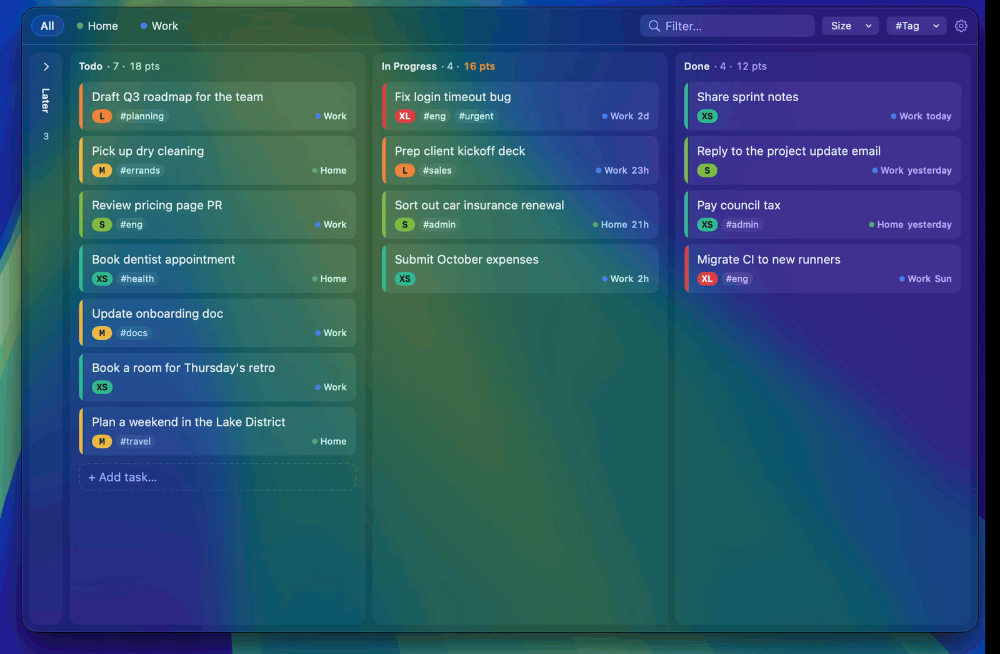
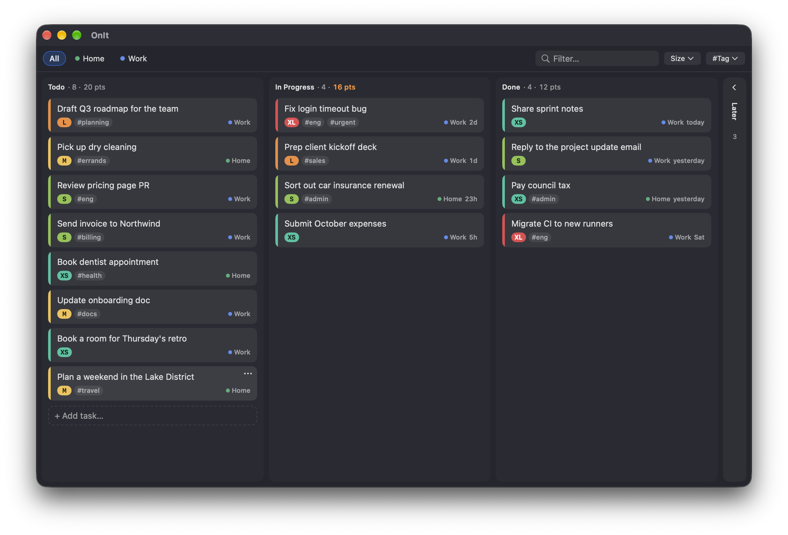
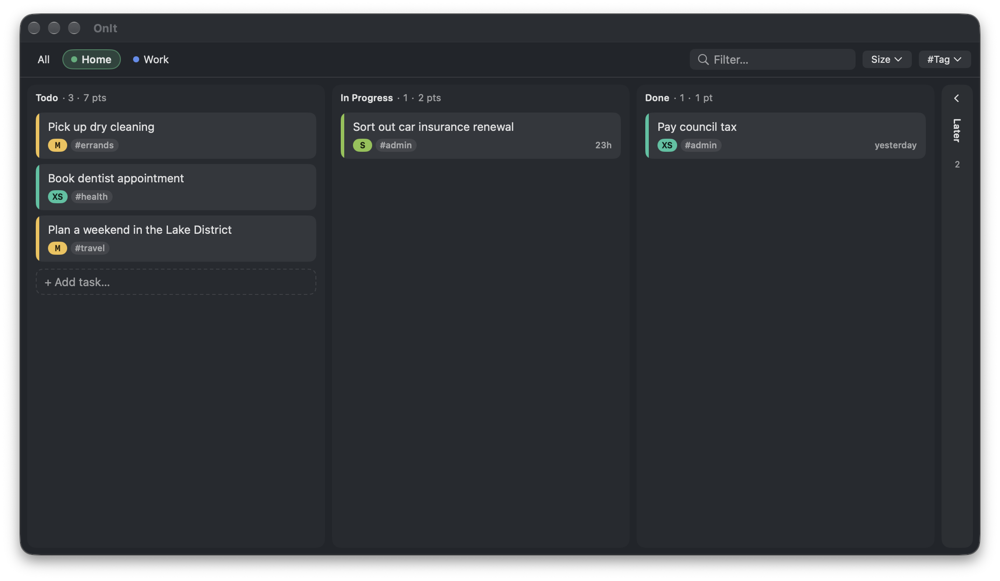
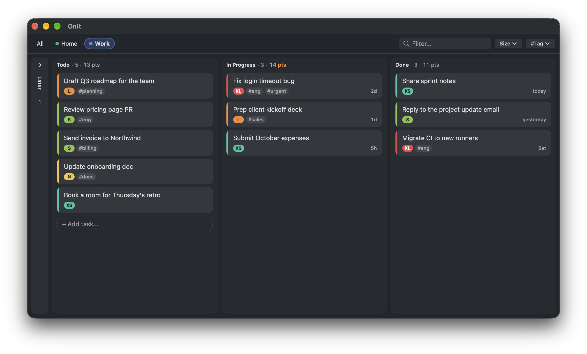

<p align="center">
  
</p>

<h1 align="center">OnIt</h1>

<p align="center"><strong>Stay “on it”.</strong><br>
A macOS board for all the small things you've said you'll do.</p>

---

“Can you update the deck?” *On it.* “Could you review this?” *On it.*

When small tasks are landing from every direction, OnIt gives them somewhere to go. Type one line and it's
on your board, sized and sorted. At a glance you can see what's waiting, what you're doing and what you finished
this week.

## Shorthand capture

Type a task the way you'd jot it down, and add a little shorthand to file it as you go:

<p align="center"></p>

```
Send invoice @work !s #billing
```

That lands on **Work**, sized **S**, tagged **billing**. Use `@` for the board, `!` for the size (`xs` to `xl`)
and `#` for tags, in any order, or skip them all. Boards also answer to short aliases like `@w`, and it
works the same in the board's add field and from Raycast.

## In your menu bar, or full screen

<table>
  <tr>
    <td width="50%"></td>
    <td width="50%"></td>
  </tr>
  <tr>
    <td align="center">Click the ✓ in the menu bar for a translucent board over whatever you're doing.</td>
    <td align="center">Or open OnIt as an app for a full window you can resize or take full screen.</td>
  </tr>
</table>

## Separate boards, kept apart

<table>
  <tr>
    <td width="50%"></td>
    <td width="50%"></td>
  </tr>
  <tr>
    <td align="center" colspan="2">Give each area its own board (a client, a project, a side hustle, home), each with its own colour. Switch with one click or ⌘1–⌘9, or view them all together.</td>
  </tr>
</table>

## Fast, tidy, private

- **Keyboard first, drag friendly.** Arrow keys to move around, ⌘-arrows to move cards, ⌥1–5 to size them,
  ⌘Z to undo. Or just drag.
- **Tidies itself.** Done tasks move to the Archive after a week, so the board stays about now.
- **Private by design.** No account, no cloud, no tracking. One readable JSON file on your Mac, with
  automatic backups.
- **Sizes, if you want them.** Size tasks XS to XL, with a colour stripe and a label you can click to change,
  and each column adds up its total. Don't need them? Turn off **Show Sizes** for a board in the **Size** menu
  for a cleaner board. Any sizes you've set are kept.

## Install

OnIt is built from source. You need macOS 14 or later, Xcode 16 or later, and
[XcodeGen](https://github.com/yonaskolb/XcodeGen). In Terminal, clone this repo, then build and install
the app:

```sh
brew install xcodegen
git clone https://github.com/KatieLG/OnIt.git
cd OnIt
xcodegen generate
xcodebuild -scheme OnIt -configuration Release -destination 'platform=macOS' -derivedDataPath build build
cp -R build/Build/Products/Release/OnIt.app /Applications/
```

Open OnIt from Applications. Turn on **Launch at login** in **Settings → General** to keep it in your menu bar.

## Integration with Raycast (optional)

If you use [Raycast](https://www.raycast.com), the two script commands in [`raycast/`](raycast) add global
shortcuts. **Add OnIt Task** captures a task from anywhere without leaving what you're doing, and
**Toggle OnIt** shows or hides the board. Link them into Raycast's scripts folder from the `OnIt` folder
you cloned:

```sh
mkdir -p ~/.config/raycast/scripts
ln -sf "$(pwd)/raycast/add-onit-task.sh" "$(pwd)/raycast/open-onit.sh" ~/.config/raycast/scripts/
```

Then in **Raycast Settings → Extensions**, click **+ → Add Script Directory**, choose
`~/.config/raycast/scripts` (press ⌘⇧G to type the path), and give both commands a hotkey.
Because they're links, keep the cloned folder where it is; the scripts stay up to date when you pull changes.

---

<sub>Your data lives in `~/Library/Application Support/OnIt/onit.json`. Automation: `onit://add?text=…`,
`onit://open` and `onit://toggle`. Developers: run tests with `xcodebuild -scheme OnIt -destination 'platform=macOS' test`.</sub>
