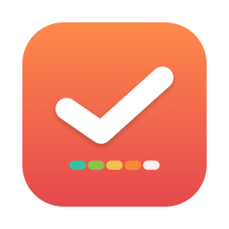

<p align="center">
  
</p>

<h1 align="center">OnIt</h1>

<p align="center"><strong>Stay “on it”.</strong><br>
A native macOS board for all the small things you've said you'll do.</p>

---

“Can you send that over?” *On it.* “Could you take a look?” *On it.*

Small asks land all day, from every direction, and they live in your head until one slips. OnIt gives them
somewhere to go. Type one line and it's on your board, sized and sorted. At a glance you can see what's
waiting, what you're doing, what you finished this week, and whether you've taken on too much.

## In your menu bar, or full screen

<table>
  <tr>
    <td width="50%"></td>
    <td width="50%"></td>
  </tr>
  <tr>
    <td align="center">Click the ✓ in the menu bar for a translucent board over whatever you're doing.</td>
    <td align="center">Or open OnIt as an app for a full window you can resize or take full screen.</td>
  </tr>
</table>

## Separate boards, kept apart

<table>
  <tr>
    <td width="50%"></td>
    <td width="50%"></td>
  </tr>
  <tr>
    <td align="center" colspan="2">Give each area its own board (a client, a project, a side hustle, home), each with its own colour.</td>
  </tr>
</table>

Look at one board at a time, or all of them together in **All**. Switch with one click or ⌘1–⌘9.
OnIt starts you off with *Home* and *Work*; rename them, recolour them, or add as many as you like.

## What makes it different

- **Sizes you can see.** Every task is XS (minutes) to XL (days), shown as a colour stripe and a label.
  Columns add up their load, and In Progress turns orange when you're carrying too much.
- **Shorthand capture.** `Send invoice @work !s #billing` puts it on Work, sized S, tagged *billing*.
  Use `@` for the board, `!` for the size and `#` for tags, or none of them.
- **Keyboard first, drag friendly.** Arrow keys to move around, ⌘-arrows to move cards, ⌥1–5 to size them,
  ⌘Z to undo. Or just drag.
- **Tidies itself.** Done tasks move to the Archive after a week, so the board stays about now.
- **Private by design.** No account, no cloud, no tracking. One readable JSON file on your Mac, with
  automatic backups.

## Install

You need macOS 14 or later, Xcode 16 or later, and [XcodeGen](https://github.com/yonaskolb/XcodeGen).

```sh
brew install xcodegen
xcodegen generate
xcodebuild -scheme OnIt -configuration Release -destination 'platform=macOS' -derivedDataPath build build
cp -R build/Build/Products/Release/OnIt.app /Applications/
```

Open OnIt from Applications. Turn on **Launch at login** in **Settings → General** to keep it in your menu bar.

## Works great with Raycast (optional)

If you use [Raycast](https://www.raycast.com), the two script commands in [`raycast/`](raycast) add global
shortcuts. **Add OnIt Task** captures a task from anywhere without leaving what you're doing, and
**Toggle OnIt** shows or hides the board. From this repo's root:

```sh
mkdir -p ~/.config/raycast/scripts
ln -sf "$(pwd)/raycast/add-onit-task.sh" "$(pwd)/raycast/open-onit.sh" ~/.config/raycast/scripts/
```

Then in **Raycast Settings → Extensions**, click **+ → Add Script Directory**, choose
`~/.config/raycast/scripts` (press ⌘⇧G to type the path), and give both commands a hotkey.
The links mean the scripts stay up to date when you pull changes.

---

<sub>Your data lives in `~/Library/Application Support/OnIt/onit.json`. Automation: `onit://add?text=…`,
`onit://open` and `onit://toggle`. Developers: run tests with `xcodebuild -scheme OnIt -destination 'platform=macOS' test`.</sub>
